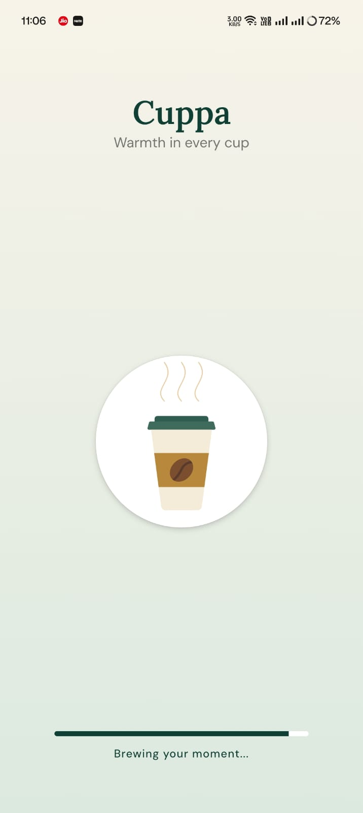
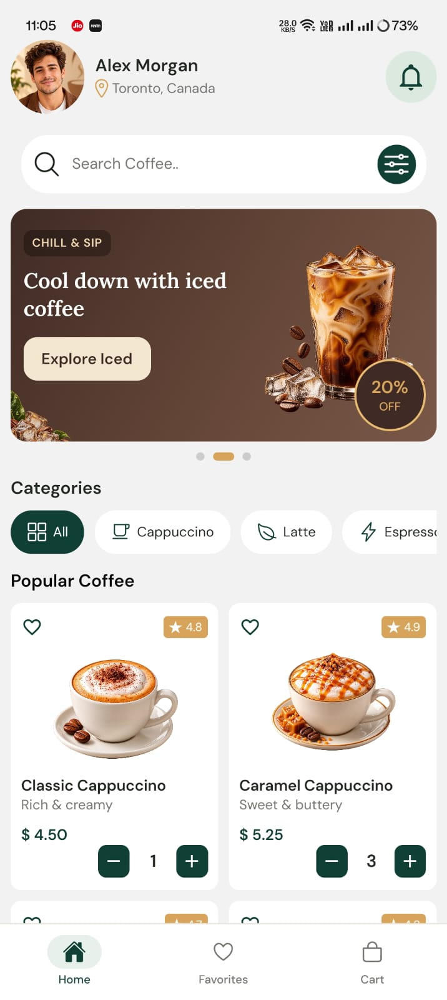
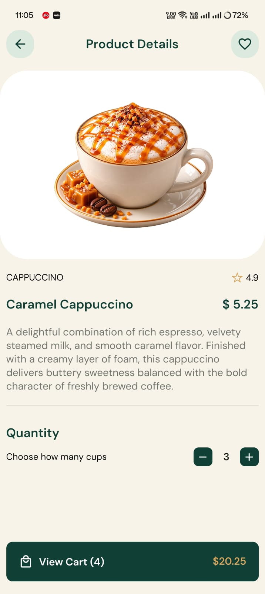
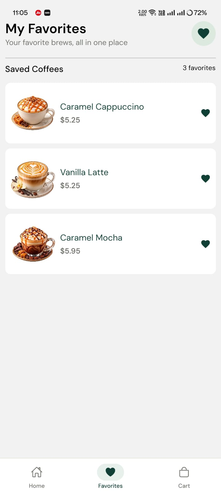
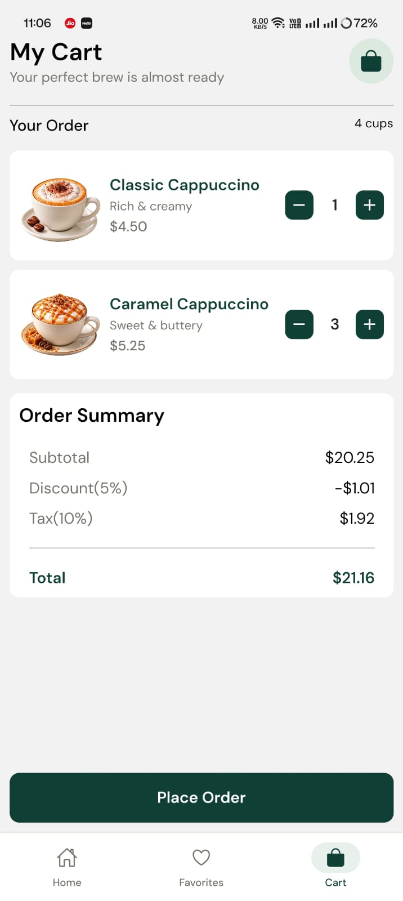

# Cuppa ☕

A polished coffee-ordering mobile app built with **React Native, Expo, and JavaScript**.

## Overview

Cuppa is a portfolio project designed to demonstrate a clean and modern mobile ordering experience. The app allows users to browse coffee products, view product details, save favorites, manage cart quantities, and review an order summary.

The project focuses on **reusable components, intuitive navigation, responsive UI, and shared state management** while keeping the architecture simple and appropriate for a portfolio application.

## Features

- ☕ Browse coffee products by category
- 🔍 View detailed information for each coffee
- ❤️ Save and manage favorite coffees
- 🛒 Add coffees to the cart and adjust quantities
- 🧾 View subtotal, discount, tax, and final total
- 🛍️ View an empty-cart state when no items are added
- 🧭 Navigate between Home, Favorites, and Cart
- 📱 Responsive mobile-friendly interface
- ✨ Animated splash screen and promotional carousel
- 🎨 Consistent custom theme, typography, and reusable UI components
- 🔄 Shared cart and favorites state using Zustand

## Tech Stack

- React Native — Mobile UI development
- Expo — Development and app tooling
- Expo Router — File-based navigation and screen structure
- JavaScript — Application logic and components
- Zustand — Shared state management for favorites and cart
- React Native Reanimated / Animated APIs — UI animations
- Expo Linear Gradient — Gradient-based visual elements
- Expo Vector Icons — Interface icons
- Custom fonts — DM Sans and Lora for typography

## Screenshots

### Splash Screen



### Home



### Product Details



### Favorites



### Cart & Order Summary



## Installation

### 1. Clone the repository

```bash
git clone https://github.com/vishalsharma-devs/cuppa-react-native
```

### 2. Navigate to the project

```bash
cd cuppa-react-native
```

### 3. Install dependencies

```bash
npm install
```

### 4. Start the Expo development server

```bash
npx expo start
```

### 5. Run the app

You can run Cuppa using:

- Android Emulator — press `a` in the Expo terminal
- iOS Simulator — press `i` on macOS
- Physical device — scan the Expo QR code with the appropriate Expo app
